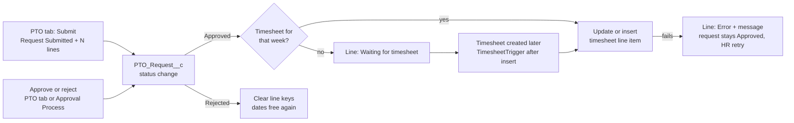

# PTO Technical Plan (v2: PTO Request + Leave Line Items)

Oct 5, 2026 · Ayan · v1 source: https://claude.ai/code/artifact/b0119739-8840-4bdf-83ad-a16ba66a600f

PTO ships as two new objects, one shared Apex validator, a PTO tab with four sections, and two automation hooks that turn approved leave into timesheet line items.

- **PTO Request** (`PTO_Request__c`): one record per submission. It holds the employee, approver, status and reason.
- **Leave Line Items** (`Leave_Line_Item__c`): one per day, holding only what's needed to build a timesheet line item.
- **Approval:** managers approve or reject whole requests.
- **Build:** on the `appexchange` branch of the `dbt` managed package (next version 2.26). Work branch: `feature/pto` (from `appexchange`).

## v2 changes from v1

v1 (commit `2415eb3`) stored one `Leave_and_Holiday__c` record per day, and managers approved each day on its own. v2 replaces that:

| v1 | v2 | Why |
| --- | --- | --- |
| `Leave_and_Holiday__c`, one record per day, carrying employee, status, approver, notes | `PTO_Request__c` (employee, status, approver, reason) + `Leave_Line_Item__c` master-detail children (date, category, hours) | A leave request is one decision, not N |
| Approve / reject per day | Approve / reject per request | Managers decide on the whole request |
| Rejected = status New; resubmitting the same date + category reused the record | Rejected is its own status. Applying again creates a new request; the rejected one stays as history | Clean audit trail; no record reuse |
| Conversion failure sent the day back to New with "Not in Timesheet" in Notes | The request stays Approved. The failed line gets `Sync_Status__c` = Error and the message; HR can retry | One bad day doesn't undo an approved request |
| Notes per day | One reason per request | Line items only hold timesheet values |
| Past and Approve: one flat table of days | Side-by-side: request list left, the selected request's line items right | Matches the request model |
| Holiday flow + `HolidayLoader` writing Type = Holiday rows | Removed for now | Holidays will be redesigned later |

Nothing was released in a package version, so v1's object, trigger, class and flow are deleted outright. No data migration is needed.

## Scope and agreed decisions

| Area | Decision |
| --- | --- |
| Records | `PTO_Request__c`, one per submission. Status: Submitted, Approved, Rejected. `Leave_Line_Item__c`, one per day, a master-detail child of the request |
| Roles | User: applies for self. Manager: applies for direct reports, sees the team heatmap, approves direct reports. HR Admin: everything, for everyone |
| Direct report | `Employee__r.Manager__c` = my user AND `Employee__r.User__r.ManagerId` = my user |
| Approver | Always the employee's manager. No manager: warning on submit; the request stays pending and HR Admin can approve it |
| Apply | Starts with one row. A date range fills weekdays (weekends optional). Existing leave is shown locked with its request number. One Reason box per request. A review screen comes before submit |
| Submit | Creates one PTO Request (Submitted) and one line item per day, in one transaction |
| Resubmit | Always a new request. A rejected request's line items have their unique key cleared, so the dates are free again |
| Validation | Per-category max from `Timesheet_Default_Value__mdt`. Same date + category is blocked against Submitted/Approved requests and absence line items. Leave + logged hours over the daily max is blocked. Over balance only warns |
| Approve / Reject | Per request, from the Approve tab's detail pane or the standard Approval Process. Reject needs a reason, written to `Decision_Notes__c` |
| Line items | Created when a request is approved and that week's timesheet exists; otherwise when the timesheet is created. Matched by employee, date and category: a match has its duration set, otherwise a new line item is inserted. A failure flags only that day (`Sync_Status__c` = Error); the rest of the request still converts |
| Past / Approve UI | Side-by-side: request list on the left, the selected request's details and line items on the right. Stacked on narrow screens |
| Holidays | **Deferred: redesigned later.** No holiday flow or loader in v2 |
| Out of scope | Cancelling approved leave; holidays |

## Data model

Two new objects, six new custom metadata fields, and two edited validation rules.

`Employee__c.Manager__c` is a lookup to **User**, not Employee. So both direct-report checks compare user ids: `Employee__r.Manager__c = :UserInfo.getUserId()` AND `Employee__r.User__r.ManagerId = :UserInfo.getUserId()`.

### New object: PTO_Request__c

Label "PTO Request". Name: auto number `PTO-{000000}`. Sharing: Private. `OwnerId` is the employee's user, also when a manager applies for them. No tab, no layout.

| Field | Type | Notes |
| --- | --- | --- |
| `Employee__c` | Lookup(Employee__c), required, restrict delete | Whose leave |
| `Status__c` | Picklist, restricted: Submitted, Approved, Rejected | Default Submitted |
| `Approver__c` | Lookup(User) | Stamped on submit from `Employee__r.Manager__c`. Blank = no manager, stays pending. Used by the Approval Process and the Approve query |
| `Notes__c` | Long Text Area(2000) | The employee's reason. Its first line becomes the timesheet line item's description |
| `Decision_Notes__c` | Long Text Area(2000) | `Approved by <name> on <date>` or `Rejected by <name> on <date>: <reason>` |
| `Decided_By__c` | Lookup(User) | Who approved or rejected |
| `Decided_On__c` | DateTime | When |
| `Start_Date__c` | Roll-up MIN(`Leave_Line_Item__c.Date__c`) | First day |
| `End_Date__c` | Roll-up MAX(`Leave_Line_Item__c.Date__c`) | Last day |
| `Total_Hours__c` | Roll-up SUM(`Leave_Line_Item__c.Duration__c`) | |
| `Day_Count__c` | Roll-up COUNT(`Leave_Line_Item__c`) | |
| `Sync_Error_Count__c` | Roll-up COUNT(`Leave_Line_Item__c`, `Sync_Status__c` = Error) | Drives "Approved, sync error" in Past |

### New object: Leave_Line_Item__c

Label "Leave Line Item". Replaces v1's `Leave_and_Holiday__c`. Name: auto number `LLI-{000000}`. Sharing: controlled by parent. No tab, no layout.

| Field | Type | Notes |
| --- | --- | --- |
| `PTO_Request__c` | Master-Detail(PTO_Request__c) | Not reparentable |
| `Date__c` | Date, required | One record per day |
| `Absence_Category__c` | Picklist, restricted | Same values as the line item field, Holiday kept for later. Packaged local picklists can't become a global value set, so values are kept in sync by hand |
| `Duration__c` | Number(4,2) | Hours, checked against custom metadata |
| `Unique_Key__c` | Text(80), unique, external id | `EmployeeId\|yyyy-MM-dd\|Category`. Set while the request is Submitted or Approved; cleared when it's rejected. Blocks the same date + category at the database level |
| `Sync_Status__c` | Picklist, restricted: Waiting for timesheet, On timesheet, Error | Default Waiting for timesheet. Written by conversion only |
| `Sync_Error__c` | Text(255) | Last conversion error |
| `Timesheet_Line_Item__c` | Lookup(Timesheet_Line_Item__c), set null | The line item this day created or updated |

There are no employee, status or notes fields on the line item. Queries read them through `PTO_Request__r` (SOQL filters and groups on parent fields).

### No change: Timesheet_Line_Item__c

No new field. A leave day is matched to existing line items by employee, date and absence category (absence rows have no project). A match gets its duration set to the leave's hours; no match gets a new line item. Setting rather than adding the hours makes a second run harmless.

### Change: Timesheet_Default_Value__mdt

Six Number(4,2) fields, subscriber-controlled, all 8 in the packaged `Default_Values` record so today's behaviour is unchanged. On Duty can be raised by the customer. (Already built in v1; no change.)

| Field | Category | Packaged value |
| --- | --- | --- |
| `Max_PTO_Planned_Hours__c` | PTO-Planned | 8 |
| `Max_PTO_Unplanned_Hours__c` | PTO-Un Planned | 8 |
| `Max_Sick_Leave_Hours__c` | Sick Leave | 8 |
| `Max_Permission_Hours__c` | Permission | 8 |
| `Max_On_Duty_Hours__c` | On Duty | 8 |
| `Max_Holiday_Hours__c` | Holiday | 8 |

The daily max stays `Maximum_Working_Hrs_Per_Day__c` (packaged value 24).

### Change: two line-item validation rules

Already built in v1; no change. `Duration` and `Eight_hour_limit_for_out_of_office` keep their names and error messages. The fixed `8` became a `CASE(TEXT(Absence_Category__c), ...)` over the six metadata fields, default 8.

## Apex

Two triggers on the new objects and the classes below, plus the existing one-line call in `TimesheetTrigger`. Conversion is triggered from the request's status change, so a request approved anywhere (the PTO tab, the standard Approval Process, a data load) is handled the same way.

### Classes and triggers

| Component | Sharing | Role |
| --- | --- | --- |
| `LeaveValidator` | without sharing | The shared rule set. Takes a list of neutral rows (employee, date, category, hours, own line id) |
| `PtoRequestService` (was `LeaveService`) | without sharing | Submit (request + lines), approve, reject, and the matching `Approval.process` calls. Trigger entry points for both objects |
| `LeaveToLineItem` | without sharing | Turns approved line items into timesheet line items, for given requests, for new timesheets, or as an HR retry |
| `PtoController` | with sharing | `@AuraEnabled` methods for the PTO tab. Checks role before every call |
| `PtoData` | without sharing | Reads behind `PtoController` for records the user doesn't own |
| `PtoRequestTrigger` | trigger | before insert/update → defaults and approver. after update → Approved: convert; Rejected: clear line keys |
| `LeaveLineItemTrigger` | trigger | before insert → key and validator. before update → only sync fields and key may change. before delete → blocked unless the request is Rejected or the user is HR |

Removed: `Leave_and_Holiday__c`, `LeaveAndHolidayTrigger`, `HolidayLoader`, `PTO_Holiday_Loader`.

### LeaveValidator

- `validate(List<Row> rows)` returns one error string per row (blank = ok). Callers attach it with `addError`, or return it to the LWC.
- Checks, in order:
    1. Hours above 0 and at most the category max from `Timesheet_Default_Value__mdt.getInstance('Default_Values')`.
    2. No line item on a Submitted or Approved request, and no absence timesheet line item, with the same employee + date + category. A row's own record is excluded.
    3. Day total ≤ `Maximum_Working_Hrs_Per_Day__c`. Day total = timesheet line items that day (attendance + absence) + leave lines on Submitted/Approved requests not yet On timesheet + the new rows.
    4. Balance: only returns a warning, never an error.
- 2 queries for any batch size:
    - `Leave_Line_Item__c WHERE PTO_Request__r.Employee__c IN :ids AND PTO_Request__r.Status__c IN ('Submitted','Approved')` in the date range
    - timesheet line items for the same set and range.
- Called from `LeaveLineItemTrigger` before insert, and from `TimesheetLineItemTriggerHandler.beforeInsert`/`beforeUpdate` for Absence rows only (rule 2 against pending leave). The existing duplicate check and the `Duration_Limit_RTF` flow stay as they are.

### PtoRequestService

- **`submit(Employee__c, List<Leave_Line_Item__c> lines, String notes)`**
    - Inserts one `PTO_Request__c`: Submitted, `Approver__c` = `Employee__r.Manager__c`, `OwnerId` = the employee's user, `Notes__c` = notes.
    - Then inserts its lines; the line trigger stamps keys and validates.
    - Both inserts share one savepoint; a line DML error index maps to the caller's row.
    - When `Leave_Approval` is active, submits the request into it (skipped silently when no process applies).
    - Returns the request id and name, plus warnings (no manager, over balance).
- **`approve(List<PTO_Request__c>)` / `reject(List<PTO_Request__c>, String reason)`**
    - Any request with an open `ProcessInstanceWorkitem` first gets `Approval.ProcessWorkitemRequest` with the same action and comment.
    - Re-reads afterwards and updates only requests still Submitted: Status, `Decided_By__c`, `Decided_On__c`, and `Decision_Notes__c` (reject: `Rejected by <name> on <date>: <reason>`).
- **Trigger entry points**
    - `beforeRequestSave`: default status, stamp approver.
    - `afterRequestUpdate`: Status → Approved calls `LeaveToLineItem.convertRequests`; Status → Rejected clears `Unique_Key__c` on its lines.
    - `beforeLineInsert` / `beforeLineUpdate` / `beforeLineDelete`: see the trigger table.
- **Approved leave is not edited.** Its line items can't change date, category or hours. Cancelling stays out of scope.

### LeaveToLineItem

- **Entry points**
    - `convertRequests(Set<Id> requestIds)`: from the request trigger when the status becomes Approved.
    - `forTimesheets(List<Timesheet__c> newTimesheets)`: from `TimesheetTrigger` after insert, for lines on Approved requests of those employees inside each timesheet's Start/End whose `Sync_Status__c` isn't On timesheet.
    - `retry(Set<Id> requestIds)`: HR only, from `PtoController.retrySync`. Re-runs the lines in Error or Waiting.
- **Matching:** for each line, find the timesheet covering its date for that employee. Then match an existing absence timesheet line item by employee + date + category across all of the employee's timesheets, so overlapping timesheets never get the same day twice.
    - Found → set `Duration__c`.
    - Not found → insert one: Type Absence, category, hours, date, employee, timesheet, `Description__c` = first line of the request's Notes.
- **Outcomes per leave line**
    - Success → `Sync_Status__c` = On timesheet, `Timesheet_Line_Item__c` set, `Sync_Error__c` cleared.
    - No timesheet for that week → stays Waiting for timesheet and is picked up when the timesheet is inserted.
    - Failure (insert/update with `allOrNone = false`) → `Sync_Status__c` = Error, `Sync_Error__c` = message. The request stays Approved; the other lines are unaffected.
- **Timesheet already Submitted or Approved:** the line item is added anyway; `TimesheetTrigger` recalculates totals and accrual.
- **Cost:** 3 queries (lines, timesheets, timesheet line items), 1 insert, 1 update of timesheet items, 1 update of leave lines for any batch size.

### PtoController

| Method | Purpose |
| --- | --- |
| `getContext()` | Current employee, balance, role flags, direct reports (for the picker), category limits, daily max, pending request count |
| `getDayRecords(employeeId, startDate, endDate)` | Existing leave lines on Submitted/Approved requests (with the request number) + timesheet line items, for the Apply table |
| `submitLeave(employeeId, rowsJson, notes)` | Role check (self, direct report, or HR), validate, `PtoRequestService.submit`. Returns errors per row, or the new request and warnings |
| `getPast(employeeId, offsetRows)` | The employee's requests, `ORDER BY Start_Date__c DESC, CreatedDate DESC LIMIT 26 OFFSET :offsetRows` |
| `getRequestLines(requestId)` | One request's header and line items, for the right-hand pane. Own, direct report's, or HR |
| `getOverview(employeeId, year)` | `SUM(Duration__c)` of leave lines grouped by category and request status, Submitted + Approved only. Available = `Total_Absence_Hours_Available__c` minus Submitted hours |
| `getTeamWeek(weekStart)` | Direct reports (or everyone for HR) × 7 days for the heatmap, from leave lines on Submitted/Approved requests |
| `getPendingApprovals()` | Submitted requests where both manager links = me; HR: all Submitted. Never your own |
| `approveRequests(ids)` / `rejectRequests(ids, reason)` | Role and ownership check per request, then `PtoRequestService` |
| `retrySync(requestId)` | HR only. `LeaveToLineItem.retry` |

Role flags come from two custom permissions, checked with `FeatureManagement.checkPermission`: `PTO_Approve_Team` and `PTO_Admin_All` (see Security).

### Per-operation budget

| Operation | Queries | DML |
| --- | --- | --- |
| Tab load (`getContext`) | 4 | 0 |
| Submit (validator + service + triggers) | 5 | 1 insert request, 1 insert lines |
| Approve or reject one request | 3 (+3 conversion) | 1 update request, n approval calls; conversion: 1 insert, 2 updates |
| Timesheet created | +3 on top of the existing trigger | 1 insert, 2 updates |
| Past page / request detail | 1 / 2 | 0 |

## Automation

A request reaches Approved or Rejected from the PTO tab or the standard Approval Process; both go through the request trigger. Approved lines become timesheet line items straight away when that week's timesheet exists; otherwise the timesheet trigger converts them when the weekly flow creates the timesheet.

### Timesheet hook

- `TimesheetTrigger` already calls `LeaveToLineItem.forTimesheets(Trigger.new)` on insert (v1). Unchanged.
- `Timesheets_Creation_STF` is not changed. Manual and demo timesheets are covered too, since they all fire the trigger.

### Approval Process (outside the package)

- `Leave_Approval` on `PTO_Request__c`.
    - Entry: Status = Submitted.
    - Approver: related user `Approver__c`.
    - Final approval: field update Status = Approved. Rejection: field update Status = Rejected.
- Kept in `unpackaged/` (Metadata API format: `package.xml`, `approvalProcesses/PTO_Request__c.Leave_Approval.approvalProcess`, `workflows/PTO_Request__c.workflow` with the two status field updates).
- Listed in `.forceignore` and deployed with `sf project deploy start --metadata-dir unpackaged`.
- The in-app Approve tab works with or without it. A decision made in the standard approval screen is stamped by the request trigger: `Decided_By__c`, `Decided_On__c` and a `Decision_Notes__c` line with the approver's comment.

### Holidays

**Deferred: redesigned later.** v1's `PTO_Holiday_Loader` flow and `HolidayLoader` class are removed. The Holiday picklist value and `Max_Holiday_Hours__c` stay for the redesign.

## LWC

Eight components behind one Lightning tab, `PTO`. The container loads the context once and renders only the open section, so each section's query runs only when it's opened.

| Component | Shown to | Does |
| --- | --- | --- |
| `ptoApp` | everyone | Tab strip on top (Overview, Apply, Past, Approve), role flags from `getContext`, Approve shows the pending request count. Refreshes children after submit or a decision. Target `lightning__Tab` |
| `ptoOverview` | everyone | Four tiles (available, taken this year, pending with request count, next leave) and hours by category with Chart.js (`jsChart`). Manager and HR: weekly heatmap with `jsChartMatrix`, ‹ › to page weeks |
| `ptoApply` | everyone | Employee (read-only for users, picker for manager and HR), start and end date, category, hours per day, weekend checkbox, Reason box. Row table with locked existing rows ("On PTO-000123, Approved"), inline errors, Add row. Review step: one request, days, hours, balance after, "can't edit after submitting", and the no-manager warning |
| `ptoPast` | everyone | Side-by-side. Left: the employee's requests, 25 per page, Previous and Next. Right: `ptoRequestDetail` for the selected request. Managers and HR get an Employee picker to open a direct report's (HR: anyone's) requests |
| `ptoApprove` | manager, HR | Side-by-side. Left: pending requests, sortable on the client. Right: `ptoRequestDetail` with Approve and Reject |
| `ptoRequestDetail` | used by Past and Approve | Request header (number, employee, dates, days, hours, status, approver, reason, decision) and its line items with timesheet status. Approve/Reject in approve mode; Retry timesheet sync for HR in past mode |
| `ptoConfirmModal` | manager, HR | `LightningModal`. Approve: confirm. Reject: required reason |
| `ptoTable` | used by Apply, Past, Approve, detail | The shared table (below), now with a selectable-row mode |

### ptoTable

A plain SLDS table, not `lightning-datatable`. The Apply table needs picklist cells, per-row errors and locked rows mixed with editable ones, which `lightning-datatable` handles poorly.

- `@api columns`: `{ fieldName, label, type: text | date | number | picklist | status, editable, sortable, options }`.
- `@api rows`: plain objects. `locked: true` greys a row and disables its inputs; `error` prints under the row.
- `@api rowActions`: buttons per row (Remove in Apply).
- `@api selectable`, `@api selectedKey`: clicking a row (or Enter on it) fires `rowselect { rowKey }`; the selected row is highlighted.
- Events: `cellchange { rowKey, fieldName, value }`, `rowaction { rowKey, action }`, `sort { fieldName, direction }`, `rowselect { rowKey }`.
- The parent owns the data; `ptoTable` only renders and reports.

### Side-by-side view (Past and Approve)

- SLDS grid: the list takes 7/12, the detail 5/12 from medium width up. Below that the panes stack, list first.
- The first request is selected on load. In Approve, after a decision the list reloads and the next request is selected.
- The detail pane loads its lines with `getRequestLines` each time the selection changes.

### Apply flow inside the component

1. Load: one empty row.
2. Dates change: fill weekdays (weekends if ticked), call `getDayRecords`, add locked rows.
3. Every edit runs the same checks on the client (limits, same date + category, day total) for instant feedback. The server runs `LeaveValidator` again on submit and its answer wins.
4. Review → Submit → `submitLeave` → toast naming the request ("PTO-000123 submitted, 5 days") → reset to one empty row, refresh Overview and Past.

## Security

Roles are carried by two custom permissions inside the existing permission sets, so `PtoController` asks one question per call instead of reading permission set names.

| | `Timesheet_User` | `TimeSheet_Manager` | `Timesheet_HR_Admin` |
| --- | --- | --- | --- |
| Custom permission | — | `PTO_Approve_Team` | `PTO_Admin_All` |
| `PTO_Request__c` | Read, Create, Edit | Read, Create, Edit | Read, Create, Edit, Delete, View All, Modify All |
| Request `Notes__c` | Read, Edit | Read, Edit | Read, Edit |
| Request `Status__c`, `Approver__c`, `Decision_Notes__c`, `Decided_By__c`, `Decided_On__c` | Read only | Read only | Read, Edit |
| `Leave_Line_Item__c` | Read, Create | Read, Create | Read, Create, Edit, Delete, View All, Modify All |
| Line `Absence_Category__c`, `Duration__c` | Read, Edit | Read, Edit | Read, Edit |
| Line `Unique_Key__c`, `Sync_Status__c`, `Sync_Error__c`, `Timesheet_Line_Item__c` | Read only | Read only | Read only |
| Request roll-ups (dates, days, hours, sync errors) | Read only | Read only | Read only |
| PTO tab | Visible | Visible | Visible |
| Apex classes | `PtoController` | `PtoController` | `PtoController` |

Required fields and master-detail fields are left out of fieldPermissions.

### Sharing

- Request OWD: Private. `OwnerId` = the employee's user, also when a manager applies for them, so the employee always sees their own requests.
- Line items follow the request's sharing (master-detail).
- Managers read and approve direct reports' requests through `PtoData` (without sharing). Every such query carries the two-link filter, and every write re-checks it per request.
- HR uses View All and Modify All from the permission set.
- The standard Approval Process gives `Approver__c` access to the request while it's pending.

### Field and system mode

- Status, approver, decision fields, keys and sync fields are set by Apex after the role check, in system mode. Users can't change them through the API or a list view because the fields are read-only for them.
- `LeaveToLineItem` runs in system mode: line items are created on the employee's timesheet whoever approved the request.

## Packaging and deployment

Everything is additive to the `dbt` package. The only edits to released components are two validation rule formulas and one call in `TimesheetTrigger`.

- **Permanent once released:** both objects, their fields and the six metadata fields can't be deleted after a released version. Field names above should be final before the first beta.
- **Picklists:** `Absence_Category__c` values on `Leave_Line_Item__c` copy the timesheet line item's. A category added later goes on both fields.
- **Approval Process:** in `unpackaged/approvalProcesses/`, with `**/approvalProcesses/**` in `.forceignore`. Deployed separately to any org that wants it.
- **Static resources:** reuse `jsChart` and `jsChartMatrix`; nothing new.
- **v1 cleanup in tsorg:** `Deploy-Delta.ps1` doesn't delete, so v1's object, trigger, `HolidayLoader`, flow, approval process and workflow are removed with a `destructiveChanges.xml` deploy before v2 goes in.
- **Dev org deploys:** `.\Deploy-Delta.ps1` from `G:\Temp_data\SF-TimeSheet` on `feature/pto`. It only picks up uncommitted files, so deploy before committing each step.
- **Package version:** created with code coverage. Test classes are deferred (user decision for this build); they're needed before the package version.

## Build order

Each step is deployable and checked in tsorg on its own.

1. **Docs.** This plan, `build-spec.md` and `pto-design-board.html`.
2. **Clean up tsorg.** Destructive deploy removing v1's object, trigger, `HolidayLoader`, flow, approval process and workflow.
3. **Data model.** Both objects, fields, roll-ups, permission sets.
4. **Apex.** `LeaveValidator`, `PtoRequestService`, `LeaveToLineItem`, both triggers, `PtoData`, `PtoController`, and the `TimesheetLineItemTriggerHandler` call.
5. **UI.** `ptoTable` selectable mode, `ptoRequestDetail`, Past, Approve, Apply, Overview, `ptoApp`.
6. **Approval Process.** Unpackaged folder for `PTO_Request__c`.
7. **Release check.** Deploy to the dev org, end-to-end checks below, then tests and the package version later.

### Checks that matter most

| Area | Case |
| --- | --- |
| Submit | 5 weekdays + reason → 1 request, 5 lines; roll-ups show dates, 5 days, 40 h |
| Validator | Over category max; duplicate date + category against a pending or approved request; different category same day allowed; day total over max incl. logged attendance; 200-line request stays at 2 validator queries |
| Reject | Request Rejected, reason in `Decision_Notes__c`, line keys cleared; applying again for the same days creates a new request |
| Direct report | Only one of the two manager links matches → not visible, approve refused |
| No manager | Submit returns the warning; HR can approve it |
| Conversion | Timesheet present → lines On timesheet now; matching absence line item → duration set, not duplicated; no timesheet → Waiting until it's inserted; run twice → same result |
| Sync error | One failing day → that line Error with a message, others On timesheet, request still Approved, Past shows "Approved, sync error"; HR retry clears it after the fix |
| Approval Process | Approving in the standard UI converts the lines; a tab decision closes the pending workitem |
| Roles | A user calling `getPendingApprovals`, `getRequestLines` for someone else's request, or applying for someone else is refused |

## Build status

v1 was built on `feature/pto` (commit `2415eb3`). v2 is built on `feature/pto` and deployed to the `tsorg` scratch org, where v1's object, trigger, classes, flow and approval process were deleted.

Tested in tsorg with the three test users (Eli: employee, Mia: manager, Nora: no manager), the HR admin, and a real demo employee (Demo Child Employee A, manager Prameela) on their actual timesheets:

- 90 API checks through the controller as each user: validation, submit, roll-ups, approval-process steps, approve/reject from the tab and from the standard approval screen, reject and apply again, guards, timesheet created later, sync error and HR retry, roles, overview and team week, paging.
- 24 browser checks in the PTO tab (Playwright), no console errors: Apply with a Reason and conflicts, Past and Approve side by side, reject and approve modals, the Past employee picker, HR retry before and after the fix, phone width.
- All 73 existing Apex tests in the org pass. `DemoDataControllerTest` now expects 3 queries for demo timesheet creation: the 2 it had plus the approved-leave lookup that `TimesheetTrigger` has run since v1.

See `build-spec.md`, "Changes made during the v2 build", for what changed from this plan.
