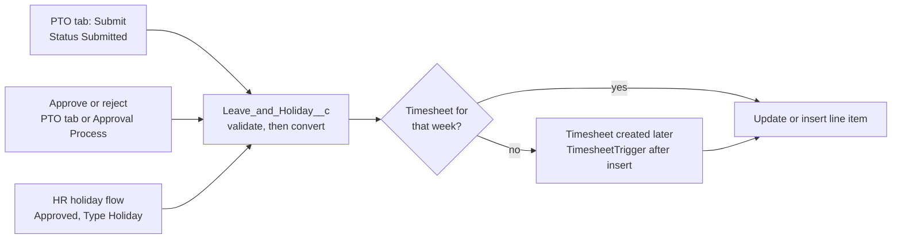

# PTO Technical Plan

Oct 2, 2026 · Ayan · Source: https://claude.ai/code/artifact/b0119739-8840-4bdf-83ad-a16ba66a600f

PTO ships as one new object, one shared Apex validator, a PTO tab with four sections, and two automation hooks that turn approved leave into timesheet line items. Built on the `appexchange` branch of the `dbt` managed package (next version 2.26). Work branch: `feature/pto` (from `appexchange`).

## Scope and agreed decisions

| Area | Decision |
| --- | --- |
| Record | `Leave_and_Holiday__c`, one record per employee per day. Type: Leave or Holiday. Status: New, Submitted, Approved. New only ever means rejected (or conversion error). |
| Roles | User: apply for self. Manager: apply for direct reports, team heatmap, approve direct reports. HR Admin: everything, for everyone. |
| Direct report | `Employee__r.Manager__c` = my user AND `Employee__r.User__r.ManagerId` = my user. |
| Approver | Always the employee's manager. No manager: warn on save, request stays pending, HR Admin can approve. |
| Apply | Starts with one row; a date range fills weekdays (weekends optional). Existing records shown locked. Review screen before submit. |
| Resubmit | Match on employee + date + category. A rejected (New) match is updated to Submitted, its old reason kept and the new note appended; otherwise insert. |
| Validation | Per-category max from `Timesheet_Default_Value__mdt`; same date + category blocked; leave + logged hours over the daily max blocked; over balance warns only. |
| Reject | Status New, reason appended to Notes. Shown as Rejected in Past; hidden from Overview and Approve. |
| Line items | Created at approval when that week's timesheet exists, otherwise when the timesheet is created. Matched to the week's line items by timesheet, employee, date and category: a match has its duration updated, otherwise a new line item. A failure sends the leave back to New with "Not in Timesheet [error]" in Notes. |
| Holidays | URL-only screen flow for HR Admin: pick year and employees, preview each holiday once as a leave row, invocable Apex creates approved Holiday rows. |
| Out of scope v1 | Cancelling approved leave. |

## Data model

One new object, six new custom metadata fields, and two edited validation rules. Nothing existing is deleted.

`Employee__c.Manager__c` is a lookup to **User**, not Employee. So both direct-report checks compare user ids: `Employee__r.Manager__c = :UserInfo.getUserId()` AND `Employee__r.User__r.ManagerId = :UserInfo.getUserId()`.

### New object: Leave_and_Holiday__c

No tab, no layout. Label "Leave and Holiday". Name is an auto number `LH-{000000}`. Sharing: Private (see Security).

| Field | Type | Notes |
| --- | --- | --- |
| `Employee__c` | Lookup(Employee__c), required, restrict delete | Whose leave |
| `Date__c` | Date, required | One record per day |
| `Type__c` | Picklist, restricted: Leave, Holiday | Default Leave |
| `Status__c` | Picklist, restricted: New, Submitted, Approved | Default Submitted. New = rejected or conversion error |
| `Absence_Category__c` | Picklist, restricted | Same values as the line item field. Packaged local picklists can't become a global value set, so values are kept in sync by hand |
| `Duration__c` | Number(4,2) | Hours, checked against custom metadata |
| `Notes__c` | Long Text Area(2000) | User note; rejection reasons, resubmit notes and conversion errors appended |
| `Approver__c` | Lookup(User) | Stamped on submit from `Employee__r.Manager__c`. Blank = no manager, stays pending. Used by the Approval Process and the Approve query |
| `Unique_Key__c` | Text(80), unique, external id | `EmployeeId` + `yyyy-MM-dd` + `Category`. Blocks same date + category at the database level and drives the resubmit upsert |

### No change: Timesheet_Line_Item__c

No new field. A leave day is matched to the week's line items by timesheet, employee, date and absence category (absence rows have no project). A match gets its duration set to the leave's hours; no match gets a new line item. Setting rather than adding the hours makes a second run harmless.

### Change: Timesheet_Default_Value__mdt

Six Number(4,2) fields, subscriber-controlled, all 8 in the packaged `Default_Values` record so today's behaviour is unchanged. On Duty can be raised by the customer.

| Field | Category | Packaged value |
| --- | --- | --- |
| `Max_PTO_Planned_Hours__c` | PTO-Planned | 8 |
| `Max_PTO_Unplanned_Hours__c` | PTO-Un Planned | 8 |
| `Max_Sick_Leave_Hours__c` | Sick Leave | 8 |
| `Max_Permission_Hours__c` | Permission | 8 |
| `Max_On_Duty_Hours__c` | On Duty | 8 |
| `Max_Holiday_Hours__c` | Holiday | 8 |

The daily max stays `Maximum_Working_Hrs_Per_Day__c` (packaged value 24).

### Change: two line-item validation rules

`Duration` and `Eight_hour_limit_for_out_of_office` keep their names and error messages. The fixed `8` becomes a lookup into the metadata record:

```
AND(
  ISPICKVAL(Type__c, "Absence"),
  Duration__c > CASE(TEXT(Absence_Category__c),
    "PTO-Planned",    $CustomMetadata.Timesheet_Default_Value__mdt.Default_Values.Max_PTO_Planned_Hours__c,
    "PTO-Un Planned", $CustomMetadata.Timesheet_Default_Value__mdt.Default_Values.Max_PTO_Unplanned_Hours__c,
    "Sick Leave",     $CustomMetadata.Timesheet_Default_Value__mdt.Default_Values.Max_Sick_Leave_Hours__c,
    "Permission",     $CustomMetadata.Timesheet_Default_Value__mdt.Default_Values.Max_Permission_Hours__c,
    "On Duty",        $CustomMetadata.Timesheet_Default_Value__mdt.Default_Values.Max_On_Duty_Hours__c,
    "Holiday",        $CustomMetadata.Timesheet_Default_Value__mdt.Default_Values.Max_Holiday_Hours__c,
    8)
)
```

The second rule keeps its narrower category filter (PTO and Sick Leave) with the same `CASE`. These rules guard records typed straight into the line item UI; the Apex validator covers everything else.

## Apex

Six new classes (including `PtoData`, the without-sharing reader behind `PtoController`) and one new trigger, plus a one-line call added to the existing `TimesheetTrigger`. Conversion to line items lives in the leave trigger, so a record approved anywhere (the PTO tab, the standard Approval Process, a data load) is handled the same way.

### Classes

| Class | Sharing | Role |
| --- | --- | --- |
| `LeaveValidator` | inherited | The shared rule set. Takes a list of neutral rows (employee, date, category, hours, own leave id, own line item id) so both objects use it |
| `LeaveService` | inherited | Submit (stamp approver and key, append notes, upsert), approve, reject, and the matching `Approval.process` calls |
| `LeaveToLineItem` | without sharing | Turns approved leave into line items, for given leave ids or for new timesheets |
| `PtoController` | with sharing | `@AuraEnabled` methods for the PTO tab. Checks role before every call |
| `HolidayLoader` | without sharing | `@InvocableMethod`s for the holiday screen flow |
| `LeaveAndHolidayTrigger` | trigger | before insert/update → validator; after insert/update → conversion when status becomes Approved |

### LeaveValidator

- `validate(List<Row> rows)` returns one error string per row (blank = ok). Callers attach it with `addError`, or return it to the LWC.
- Checks, in order:
    1. Hours above 0 and at most the category max from `Timesheet_Default_Value__mdt.getInstance('Default_Values')`.
    2. No Submitted or Approved leave, and no absence line item, with the same employee + date + category. A row's own record is excluded.
    3. Day total ≤ `Maximum_Working_Hrs_Per_Day__c`. Day total = line items that day (attendance + absence) + Submitted/Approved leave with no matching line item yet + the new rows.
    4. Balance: only returns a warning, never an error.
- 2 queries for any batch size: leave for the employee set between the min and max date, and line items for the same set and range.
- Called from the leave trigger for every insert/update, and from `TimesheetLineItemTriggerHandler.beforeInsert`/`beforeUpdate` for Absence rows only (rule 2 against pending leave). The existing duplicate check and the `Duration_Limit_RTF` flow stay as they are.

### LeaveService

- `submit(List<Leave_and_Holiday__c>)`: sets Status Submitted, `Approver__c` = `Employee__r.Manager__c`, `Unique_Key__c`, `OwnerId` = employee's user. Loads rejected (New) records with the same keys and appends the new note after the old reason. Then `upsert` on `Unique_Key__c`. When `Leave_Approval` is active, also submits each record into it (skipped silently when no process applies). Returns warnings: no manager, over balance.
- `approve(Set<Id>)` / `reject(Set<Id>, String reason)`: update status (reject also appends `Rejected by <name> on <date>: <reason>` to Notes). For any record with an open `ProcessInstanceWorkitem`, also sends `Approval.ProcessWorkitemRequest` with the same action and comment.
- The trigger does the line item work after approve, so `LeaveService` never calls `LeaveToLineItem` directly.

### LeaveToLineItem

- `convert(Set<Id> leaveIds)`: called from the trigger when Status changes to Approved.
- `forTimesheets(List<Timesheet__c> newTimesheets)`: called from `TimesheetTrigger` after insert, for approved leave of those employees inside each timesheet's Start/End.
- Matching: for each leave day, find the line item on that employee's timesheet with the same `Date__c`, `Employee__c` and `Absence_Category__c` (Type Absence). Found → set `Duration__c` to the leave's hours. Not found → insert one (Type Absence, category, hours, date, employee, timesheet, `Description__c` = Notes).
- No timesheet for that week → the leave stays Approved and is picked up when the timesheet is inserted.
- Timesheet already Submitted or Approved → line item added anyway; `TimesheetTrigger` recalculates totals and accrual.
- Failures: insert and update run with `allOrNone = false`. Each failed day's leave goes to Status New with `Not in Timesheet [<error>]` appended to Notes. Past shows it as Conversion error; the employee can resubmit from Apply.
- 3 queries (leave, timesheets, line items), 1 insert, 1 update for any batch size.

### PtoController

| Method | Cacheable | Purpose |
| --- | --- | --- |
| `getContext()` | yes | Current employee, balance, role flags, direct reports (for the picker), category limits, daily max |
| `getDayRecords(employeeId, startDate, endDate)` | no | Existing leave + line items for the Apply table |
| `submitLeave(employeeId, rows)` | no | Role check (self, direct report, or HR), validate, `LeaveService.submit`. Returns errors per row or warnings |
| `getPast(employeeId, offsetRows)` | no | `ORDER BY Date__c DESC LIMIT 26 OFFSET :offsetRows` |
| `getOverview(employeeId, year)` | yes | `SUM(Duration__c)` grouped by category, Submitted + Approved only. Available = `Total_Absence_Hours_Available__c` minus Submitted hours not yet on a timesheet |
| `getTeamWeek(weekStart)` | no | Direct reports (or everyone for HR) × 7 days for the heatmap |
| `getPendingApprovals()` | no | Submitted where both manager links = me; HR: all Submitted |
| `approveLeave(ids)` / `rejectLeave(ids, reason)` | no | Role and ownership check, then `LeaveService` |

Role flags come from two new custom permissions, checked with `FeatureManagement.checkPermission`: `PTO_Approve_Team` and `PTO_Admin_All` (see Security).

### HolidayLoader

- Two invocable actions for the flow: `previewHolidays` and `createHolidays`.
- One `@InvocableMethod` (`HolidayLoader.run`) with an `action` input of Preview or Create; the flow calls it twice.
- `previewHolidays(year, employeeIds, hours)`: reads every `Holiday` record, expands its recurrence (one-off, daily, weekly, monthly, nth weekday, yearly) into the dates inside the year, skips weekends, and returns one row per holiday date (not per employee), each marked New, Exists or Needs update (hours differ) from `Unique_Key__c`.
- `createHolidays(rows)`: upserts approved Type Holiday rows on `Unique_Key__c`, so a second run adds nothing. The leave trigger then converts any whose timesheet exists.
- Above 5,000 rows it hands off to a Queueable to stay under the 10,000 DML row limit.

### Per-operation budget

| Operation | Queries | DML |
| --- | --- | --- |
| Tab load (`getContext`) | 3 | 0 |
| Submit (validator + service + trigger) | 5 | 1 upsert |
| Approve or reject a page of rows | 4 (+1 timesheets, +2 conversion) | 1 update, 1 insert, n approval calls |
| Timesheet created | +3 on top of the existing trigger | 1 insert, 1 update |
| Holiday run | 3 | 1 upsert, or Queueable |

## Automation



A leave record reaches Approved from three places. The leave trigger makes the line item straight away if that week's timesheet exists; otherwise the timesheet trigger makes it when the weekly flow creates the timesheet.

### Timesheet hook

- `TimesheetTrigger` already has an after-insert branch. Add one call at its top: `LeaveToLineItem.forTimesheets(Trigger.new)` when `Trigger.isInsert`.
- `Timesheets_Creation_STF` is not changed. Manual and demo timesheets are covered too, since they all fire the trigger.

### Approval Process (outside the package)

- `Leave_Approval` on `Leave_and_Holiday__c`. Entry: Status = Submitted. Approver: related user `Approver__c`. Final approval: field update Status = Approved. Rejection: field update Status = New.
- Kept in `unpackaged/` (Metadata API format: `package.xml`, `approvalProcesses/`, `workflows/` with the two status field updates), listed in `.forceignore`, deployed with `sf project deploy start --metadata-dir unpackaged`.
- The in-app Approve tab works with or without it. Rejecting through the standard approval screen keeps the reason in approval history only, not in Notes.

### Holiday screen flow

- `PTO_Holiday_Loader`, a screen flow. Screens: pick year → pick employees (active only, filter by Employment Type) and hours per day → preview of the holidays as leave rows, one per date, marked New, Exists or Needs update, from `previewHolidays` → confirm → `createHolidays`.
- Not placed on any app, tab, utility bar or action. HR opens `/flow/dbt__PTO_Holiday_Loader`.
- Flow access is restricted to the HR Admin permission set ("Override default behavior and restrict access").

## LWC

Seven components behind one Lightning tab, `PTO`. The container loads the context once and renders only the open section, so each section's query runs only when it's opened.

| Component | Shown to | Does |
| --- | --- | --- |
| `ptoApp` | everyone | Tab strip on top (Overview, Apply, Past, Approve), role flags from `getContext`, refreshes children after submit or approve. Target `lightning__Tab` |
| `ptoOverview` | everyone | Four tiles (available, taken this year, pending, next leave) and hours by category with Chart.js (`jsChart`). Manager and HR: weekly heatmap with `jsChartMatrix`, ‹ › to page weeks |
| `ptoApply` | everyone | Employee (read-only for users, picker for manager and HR), start and end date, category, hours per day, weekend checkbox. Row table with locked existing rows, inline errors, Add row. Review step with days, hours, balance after, "can't edit after submitting", and the no-manager warning |
| `ptoPast` | everyone | Read-only table, 25 rows, Previous and Next. New is shown as Rejected, or as Conversion error when its latest note is a Not in Timesheet entry |
| `ptoApprove` | manager, HR | Pending rows, one per day, sort by column on the client, Approve and Reject per row |
| `ptoConfirmModal` | manager, HR | `LightningModal`. Approve: confirm. Reject: required reason |
| `ptoTable` | used by Apply, Past, Approve | The shared table (below) |

### ptoTable

A plain SLDS table, not `lightning-datatable`. The Apply table needs picklist cells, per-row errors and locked rows mixed with editable ones, which `lightning-datatable` handles poorly.

- `@api columns`: `{ fieldName, label, type: text | date | number | picklist | status, editable, sortable, options }`.
- `@api rows`: plain objects; `locked: true` greys a row and disables its inputs; `error` prints under the row.
- `@api rowActions`: buttons per row (Approve, Reject, Remove).
- Events: `cellchange { rowKey, fieldName, value }`, `rowaction { rowKey, action }`, `sort { fieldName, direction }`.
- The parent owns the data; `ptoTable` only renders and reports.

### Apply flow inside the component

1. Load: one empty row.
2. Dates change: fill weekdays (weekends if ticked), call `getDayRecords`, add locked rows.
3. Every edit runs the same checks on the client (limits, same date + category, day total) for instant feedback. The server runs `LeaveValidator` again on submit and its answer wins.
4. Review → Submit → `submitLeave` → toast → reset to one empty row, refresh Overview and Past.

## Security

Roles are carried by two new custom permissions inside the existing permission sets, so `PtoController` asks one question per call instead of reading permission set names.

| | `Timesheet_User` | `TimeSheet_Manager` | `Timesheet_HR_Admin` |
| --- | --- | --- | --- |
| Custom permission | — | `PTO_Approve_Team` | `PTO_Admin_All` |
| Leave object | Read, Create, Edit | Read, Create, Edit | Read, Create, Edit, Delete, View All, Modify All |
| `Status__c`, `Approver__c`, `Unique_Key__c` | Read only | Read only | Read, Edit |
| PTO tab | Visible | Visible | Visible |
| Apex classes | `PtoController` | `PtoController` | `PtoController`, `HolidayLoader` |
| Holiday flow | — | — | Run |

### Sharing

- Leave OWD: Private. `OwnerId` = the employee's user, also when a manager applies for them, so the employee always sees their own leave (confirmed).
- Managers read and approve direct reports' records through a `without sharing` inner class in `PtoController`. Every such query carries the two-link filter, and every write re-checks it per record.
- HR uses View All and Modify All from the permission set.
- The standard Approval Process gives `Approver__c` access to the record while it's pending.

### Field and system mode

- Reads in `PtoController` use `WITH USER_MODE`, except the manager inner class above.
- Status, approver and key are set by Apex after the role check, written with `AccessLevel.SYSTEM_MODE`. Users can't change Status through the API or a list view because the field is read-only for them.
- `LeaveToLineItem` and `HolidayLoader` run in system mode: line items are created for the employee's timesheet whoever approved the leave.

## Packaging and deployment

Everything is additive to the `dbt` package; the only edits to released components are two validation rule formulas and one call in `TimesheetTrigger`.

- **Permanent once released:** the object, its fields and the six metadata fields can't be deleted after a released version. Field names above should be final before the first beta.
- **Picklists:** `Absence_Category__c` values on the new object copy the line item's. A category added later goes on both fields.
- **Approval Process:** in `unpackaged/approvalProcesses/`, with `**/approvalProcesses/**` added to `.forceignore`. Deployed separately to any org that wants it.
- **Holiday flow:** packaged and active. A screen flow does nothing until someone opens it, and only HR Admin can open it, by URL.
- **Static resources:** reuse `jsChart` and `jsChartMatrix`; nothing new.
- **Dev org deploys:** `.\Deploy-Delta.ps1` from `G:\Temp_data\SF-TimeSheet` on `feature/pto`. It only picks up uncommitted files, so deploy before committing each step.
- **Package version:** created with code coverage; new classes target 90% or more so the package stays well above 75%.

## Tests and build order

Eight steps, each deployable and tested on its own, so the org is never left half-wired.

1. **Data model.** Object, fields, metadata fields and values, the two validation rule formulas.
2. **Validator.** `LeaveValidator`, `LeaveAndHolidayTrigger` (before only), the Absence call in `TimesheetLineItemTriggerHandler`. Test: `LeaveValidatorTest`.
3. **Service and conversion.** `LeaveService`, `LeaveToLineItem`, trigger after-update branch, the `TimesheetTrigger` call. Tests: `LeaveServiceTest`, `LeaveToLineItemTest`, plus cases added to the existing timesheet tests.
4. **Controller and access.** `PtoController`, the two custom permissions, permission set changes. Test: `PtoControllerTest` with `System.runAs` for user, manager and HR.
5. **UI.** `ptoTable`, then Past, Apply, Approve with `ptoConfirmModal`, Overview, `ptoApp` and the PTO tab.
6. **Holidays.** `HolidayLoader`, `PTO_Holiday_Loader` flow. Test: `HolidayLoaderTest` (Holiday records can be inserted in tests).
7. **Approval Process.** Unpackaged folder and `.forceignore` entry.
8. **Release check.** Deploy to the dev org, run all tests, create the package version.

### Test cases that matter most

| Area | Case |
| --- | --- |
| Validator | Over category max; duplicate date + category; different category same day allowed; day total over max incl. logged attendance; 200-row batch stays at 2 queries |
| Resubmit | Rejected row with the same key is updated, old reason kept, new note appended; no second record |
| Direct report | Only one of the two manager links matches → not visible, approve refused |
| No manager | Submit returns the warning; HR can approve it |
| Conversion | Timesheet present → line item now; matching absence line item → duration set, not duplicated; no timesheet → nothing until it's inserted; run twice → same result |
| Conversion error | Failed insert → leave back to New with `Not in Timesheet [error]` in Notes; other days in the batch still convert |
| Approval Process | Pending workitem is approved or rejected along with the in-app action |
| Holidays | Preview expands each recurrence type within the year, one row per holiday date with New/Exists/Needs update; second run adds nothing; weekends skipped; above 5,000 rows goes to the Queueable |
| Roles | User calling `getPendingApprovals` or applying for someone else is refused |

## Settled open points

- **Approval Process submission:** when `Leave_Approval` is active, Submit also sends each record into it; skipped silently when no process applies.
- **Timesheet already Submitted or Approved:** the line item is added anyway; `TimesheetTrigger` recalculates.
- **Conversion fails:** the leave goes back to New with "Not in Timesheet [error]" appended to Notes; Past shows Conversion error.
- **Holidays:** every Holiday record is expanded into its dates for the chosen year; HR sees one preview row per holiday date, with what already exists or needs updating, before anything is created. (Low priority for v1.)
- **Overview "Available":** subtracts Submitted hours that aren't on a timesheet yet.

## Build status

Built on `feature/pto` and tested in the `tsorg` scratch org with three test users (employee, manager, user without a manager) plus the HR admin. See `build-spec.md`, "Changes made during org testing", for what changed from this plan.
