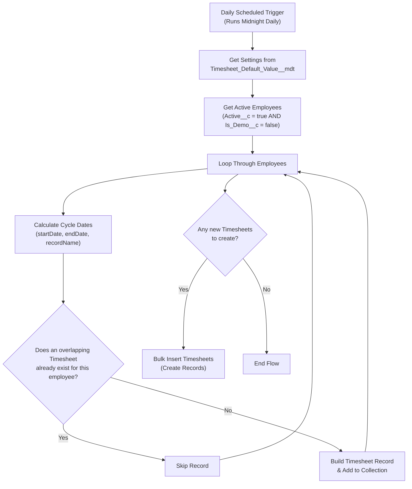

# Salesforce Timesheet App – Flexible Timesheet Dates & Pay Cycles Guide

Welcome to the **Flexible Timesheet Dates & Pay Cycles** guide. This document details how administrators can configure and manage variable timesheet cycles (Weekly, Bi-Weekly, Monthly, and Custom durations) within the Salesforce Timesheet application, eliminating the limitation of fixed Monday–Sunday schedules.

---

## Table of Contents
1. [Overview & Business Need](#1-overview--business-need)
2. [Data Model & Custom Metadata](#2-data-model--custom-metadata)
3. [Supported Timesheet Cycles](#3-supported-timesheet-cycles)
   - [Weekly (Monday or Sunday Start)](#weekly-cycle)
   - [Bi-Weekly (14-Day Cycle)](#bi-weekly-cycle)
   - [Monthly (Calendar Month)](#monthly-cycle)
   - [Custom Duration (N Days)](#custom-duration-cycle)
4. [Automation Architecture (`Timesheets_Creation_STF`)](#4-automation-architecture-timesheets_creation_stf)
   - [Why Daily Scheduled Execution is Required](#why-daily-scheduled-execution-is-required)
   - [Duplicate Prevention & Overlap Logic](#duplicate-prevention--overlap-logic)
   - [Flow Calculation Approaches: Formulas vs Invocable Apex](#flow-calculation-approaches)
5. [Apex Service Reference (`TimesheetCycleService`)](#5-apex-service-reference-timesheetcycleservice)
6. [User Interface & LWC Compatibility](#6-user-interface--lwc-compatibility)
7. [Downstream System Interactions](#7-downstream-system-interactions)
   - [Submission Reminders & Follow-Up Flows](#submission-reminders--follow-up-flows)
   - [PTO Tab & Leave Synchronization](#pto-tab--leave-synchronization)
   - [PDF Export & Reports](#pdf-export--reports)
8. [Step-by-Step Administrator Setup Guide](#8-step-by-step-administrator-setup-guide)
9. [Frequently Asked Questions & Troubleshooting](#9-frequently-asked-questions--troubleshooting)

---

## 1. Overview & Business Need

Standard time-tracking systems often assume a strict 7-day Monday-to-Sunday cycle. However, modern organizations operate across different corporate payroll cadences:
- **Bi-Weekly payroll:** Common in North American corporations (every 2 weeks / 14 days).
- **Monthly cycles:** Common in EMEA and APAC, where timesheets run from the 1st of each calendar month through the last day (28, 29, 30, or 31).
- **Alternative week starts:** Workweeks starting on Sunday rather than Monday.
- **Custom sprint/project rotations:** Fixed 10-day or 15-day periods.

The **Flexible Dates** enhancement provides a declarative, centralized way to define timesheet cycles via Salesforce Custom Metadata without breaking the weekly grid UI, timesheet reminders, or approval workflows.

---

## 2. Data Model & Custom Metadata

Timesheet date calculation rules are stored in the **`Timesheet_Default_Value__mdt`** Custom Metadata Type. This allows administrators to adjust payroll cycles directly in Salesforce Setup without modifying code or redeploying flows.

### Metadata Schema (`Timesheet_Default_Value__mdt`)

| Field Name | API Name | Type | Description / Allowed Values |
|---|---|---|---|
| **Timesheet Cycle Type** | `Timesheet_Cycle_Type__c` | Picklist | `Weekly` *(Default)*, `Bi-Weekly`, `Monthly`, `Custom` |
| **Week Start Day** | `Week_Start_Day__c` | Picklist | `Monday` *(Default)*, `Sunday` |
| **Timesheet Duration Days** | `Timesheet_Duration_Days__c` | Number(4, 0) | Required when Cycle Type is `Custom` (e.g., `10`, `14`, `15`) |
| **Working Hours Per Day** | `Working_Hours_Per_Day__c` | Number(4, 1) | Expected daily baseline (default: `8.0`) |
| **Working Days Per Week** | `Working_Days_per_Week__c` | Number(2, 0) | Expected business days per week (default: `5.0`) |

### Default Record: `Default_Values`
Located at `customMetadata/Timesheet_Default_Value.Default_Values.md-meta.xml`:
```xml
<values>
    <field>Timesheet_Cycle_Type__c</field>
    <value xsi:type="xsd:string">Weekly</value>
</values>
<values>
    <field>Week_Start_Day__c</field>
    <value xsi:type="xsd:string">Monday</value>
</values>
<values>
    <field>Timesheet_Duration_Days__c</field>
    <value xsi:type="xsd:double">7.0</value>
</values>
```

---

## 3. Supported Timesheet Cycles

### Weekly Cycle
- **Cycle Type:** `Weekly`
- **Duration:** 7 days.
- **Start Day Options:**
  - **Monday Start:** Monday through Sunday.
  - **Sunday Start:** Sunday through Saturday.
- **Calculation:**
  - Start Date: Relative to reference date, shifts backward to the nearest designated start weekday.
  - End Date: `Start Date + 6 days`.

### Bi-Weekly Cycle
- **Cycle Type:** `Bi-Weekly`
- **Duration:** 14 days (2 consecutive calendar weeks).
- **Start Day:** Aligns with the configured `Week_Start_Day__c` (Monday or Sunday).
- **Calculation:**
  - Start Date: Aligned to the base week start day.
  - End Date: `Start Date + 13 days`.

### Monthly Cycle
- **Cycle Type:** `Monthly`
- **Duration:** Calendar month (variable: 28, 29, 30, or 31 days).
- **Calculation:**
  - Start Date: First day of the calendar month (`DATE(YEAR(refDate), MONTH(refDate), 1)`).
  - End Date: Last day of the calendar month (automatically handles leap years and variable month lengths).
  - Example: `2026-02-01` to `2026-02-28`, `2026-11-01` to `2026-11-30`.

### Custom Duration Cycle
- **Cycle Type:** `Custom`
- **Duration:** Defined by `Timesheet_Duration_Days__c` (e.g., 10 days, 15 days).
- **Calculation:**
  - Start Date: Derived from configured week start day or cycle origin.
  - End Date: `Start Date + (Timesheet_Duration_Days__c - 1)`.

---

## 4. Automation Architecture (`Timesheets_Creation_STF`)



### Why Daily Scheduled Execution is Required

> [!IMPORTANT]
> The scheduled flow **must run with Daily frequency** (`<frequency>Daily</frequency>`).

When timesheet cycles are flexible, running a flow **weekly on Mondays is no longer sufficient**:
1. **Monthly Cycles:** The 1st day of a calendar month can fall on any day of the week (e.g., Wednesday or Saturday). A weekly Monday flow would only create monthly timesheets days after the month has already started.
2. **Sunday Start Weeks:** A Monday-only flow would always create Sunday-start timesheets 24 hours late.
3. **Daily Trigger Benefit:** By running every night at 00:00, the flow checks whether an active employee needs a timesheet for today. If a new cycle starts today, the timesheet is created immediately.

### Duplicate Prevention & Overlap Logic

To ensure the daily scheduled flow does not create duplicate records on days 2 through 7 (or 2 through 30), a lookup decision is executed in the employee loop:

```
Object: Timesheet__c
Filters:
  1. Employee__c          EQUALS  {!Employee_Loop.Id}
  2. Start_Date__c        <=      {!endDate}
  3. End_Date__c          >=      {!startDate}
  4. Is_Demo__c           EQUALS  false
```

- **If Found (`Id` Is Null = False):** An active timesheet already covers this cycle. The loop skips creation.
- **If Not Found (`Id` Is Null = True):** The employee does not yet have a timesheet for this cycle. The record is staged for creation.

### Flow Calculation Approaches

#### Approach 1: Invocable Apex Action (Recommended)
Use `TimesheetCycleService.calculateCycleDates` directly within the flow.
- **Input:** `referenceDate = TODAY()`
- **Outputs:** `startDate`, `endDate`, `recordName`
- **Advantage:** Centralized logic, robust edge-case handling (leap years, 28/31 day months), and full Apex test coverage.

#### Approach 2: Native Flow Formulas
If maintaining pure declarative flow elements without Apex actions:

- **`cycleType`** (Text Formula):
  ```text
  IF(ISBLANK(TEXT({!Get_Default_Values.Timesheet_Cycle_Type__c})), "Weekly", TEXT({!Get_Default_Values.Timesheet_Cycle_Type__c}))
  ```
- **`weekStartDay`** (Text Formula):
  ```text
  IF(ISBLANK(TEXT({!Get_Default_Values.Week_Start_Day__c})), "Monday", TEXT({!Get_Default_Values.Week_Start_Day__c}))
  ```
- **`startDate`** (Date Formula):
  ```text
  IF({!cycleType} = "Monthly",
      DATE(YEAR(TODAY()), MONTH(TODAY()), 1),
      IF({!weekStartDay} = "Sunday",
          TODAY() - (WEEKDAY(TODAY()) - 1),
          TODAY() - IF(WEEKDAY(TODAY()) = 1, 6, WEEKDAY(TODAY()) - 2)
      )
  )
  ```
- **`endDate`** (Date Formula):
  ```text
  IF({!cycleType} = "Monthly",
      IF(MONTH({!startDate}) = 12,
          DATE(YEAR({!startDate}), 12, 31),
          DATE(YEAR({!startDate}), MONTH({!startDate}) + 1, 1) - 1
      ),
      IF({!cycleType} = "Bi-Weekly",
          {!startDate} + 13,
          IF({!cycleType} = "Custom" && NOT(ISBLANK({!Get_Default_Values.Timesheet_Duration_Days__c})),
              {!startDate} + {!Get_Default_Values.Timesheet_Duration_Days__c} - 1,
              {!startDate} + 6
          )
      )
  )
  ```
- **`Record_Name`** (Text Formula):
  ```text
  "Timesheet for " + TEXT({!startDate}) + " to " + TEXT({!endDate})
  ```

---

## 5. Apex Service Reference (`TimesheetCycleService`)

The service class `TimesheetCycleService.cls` manages timesheet calculation logic programmatically:

### Invocable Signature for Flows
```apex
@InvocableMethod(
    label='Calculate Timesheet Cycle Dates' 
    description='Calculates Start Date, End Date, and Record Name based on Timesheet Default Value metadata.'
)
public static List<CycleResult> calculateCycleDates(List<CycleRequest> requests)
```

### Key Methods
- **`getCycleDates(Date referenceDate)`**: Computes the `startDate`, `endDate`, and `recordName` based on active custom metadata values.
- **`calculateWeekStartDate(Date refDate, String weekStartDay)`**: Computes the Monday or Sunday base start date for any calendar date using a fixed reference origin.
- **`mockSettings` (@TestVisible)**: Allows Apex test classes to simulate any combination of Cycle Type, Duration, and Start Day without DML on Custom Metadata.

---

## 6. User Interface & LWC Compatibility

The Timesheet Entry Grid ([testLineItem.js](file:///C:/Development/VS%20Code/SF-TimeSheet-Fresh/Timesheet/main/default/lwc/testLineItem/testLineItem.js)) dynamically adapts to any date range specified on `Timesheet__c`:

```javascript
// In testLineItem.js:
let totalDays = 7;
if (this.TimeSheetEndDate) {
    const endDateObj = this.localDateFromServer(this.TimeSheetEndDate);
    if (endDateObj && endDateObj >= startDateObj) {
        const diffMs = endDateObj.getTime() - startDateObj.getTime();
        totalDays = Math.round(diffMs / (1000 * 60 * 60 * 24)) + 1;
    }
}
```

### What this means for end users:
1. **Dynamic Grid Columns:** If a timesheet is 14 days (Bi-Weekly), the grid renders 14 daily input columns. If it is a 30-day month, it renders all 30 days.
2. **Column Headers:** Daily dates, day names (Monday, Tuesday, etc.), and weekend highlighting automatically follow each day's exact calendar date.
3. **Daily & Row Totals:** Row totals, billable calculations, and daily column sums automatically size to `totalDays`.

---

## 7. Downstream System Interactions

| Feature / Process | Interaction with Flexible Dates | Status |
|---|---|---|
| **Timesheet Reminder Flow** (`Timesheet_Remainder_STF`) | Uses formula `ISBLANK({!$Record.End_Date__c}) \|\| ({!$Record.End_Date__c} - TODAY() <= 2)`. Reminders send 2 days prior to `End_Date__c` regardless of cycle length. | Fully Compatible |
| **Submission Follow-Up** (`Timesheet_Submission_Follow_up_Email`) | Triggers relative to submission and approval due dates calculated from `End_Date__c`. | Fully Compatible |
| **PTO & Absence Sync** (`LeaveToLineItem.cls`) | Absence sync matches leave dates against `Start_Date__c <= Date__c AND End_Date__c >= Date__c`. Absences map seamlessly into weekly, bi-weekly, or monthly sheets. | Fully Compatible |
| **PDF Generation** (`createPDF.js`) | Queries `Start_Date__c` and `End_Date__c` dynamically; outputs date range in document header and prints all active date rows. | Fully Compatible |

---

## 8. Step-by-Step Administrator Setup Guide

### How to Change the Organization's Timesheet Cycle:

1. **Log in** as a Salesforce Administrator.
2. Navigate to **Setup** > **Custom Code** > **Custom Metadata Types**.
3. Locate **Timesheet Default Value** and click **Manage Records**.
4. Click **Edit** next to **Default Values**.
5. Update the desired settings:
   - To switch to Sunday-start weeks: Set **Week Start Day** to `Sunday`.
   - To switch to Bi-Weekly: Set **Timesheet Cycle Type** to `Bi-Weekly`.
   - To switch to Monthly: Set **Timesheet Cycle Type** to `Monthly`.
   - To set a custom duration (e.g. 10 days): Set **Timesheet Cycle Type** to `Custom` and enter `10` in **Timesheet Duration Days**.
6. Click **Save**.
7. Ensure the scheduled flow **`Timesheets_Creation_STF`** is **Active** and scheduled **Daily**.

---

## 9. Frequently Asked Questions & Troubleshooting

#### Q: What happens to existing historical timesheets when we change the cycle type?
**A:** Existing timesheets remain untouched. Their `Start_Date__c`, `End_Date__c`, and line items are stored permanently on each record. Only newly generated timesheets adopt the new cycle configuration.

#### Q: How does the system handle an employee hired mid-cycle?
**A:** If an employee is marked active mid-cycle, the flow creates a timesheet covering the current cycle period. The employee logs hours only for days on or after their start date.

#### Q: Why are duplicate timesheets not created when the flow runs every single day?
**A:** The `Get_Existing_Timesheet` lookup check in the flow filters for any existing non-demo timesheet where `Start_Date__c <= endDate` and `End_Date__c >= startDate`. On days 2 through the end of the period, this check evaluates to true, causing the flow to safely skip creation until the next cycle begins.

#### Q: Can different employees have different cycles (e.g., Weekly for contractors, Monthly for salaried)?
**A:** Currently, the cycle is governed globally via `Timesheet_Default_Value__mdt`. If employee-level flexibility is needed in the future, a `Timesheet_Cycle_Type__c` override field can be added to `Employee__c`, allowing the flow to prioritize the employee's specific cycle over the organization default.
